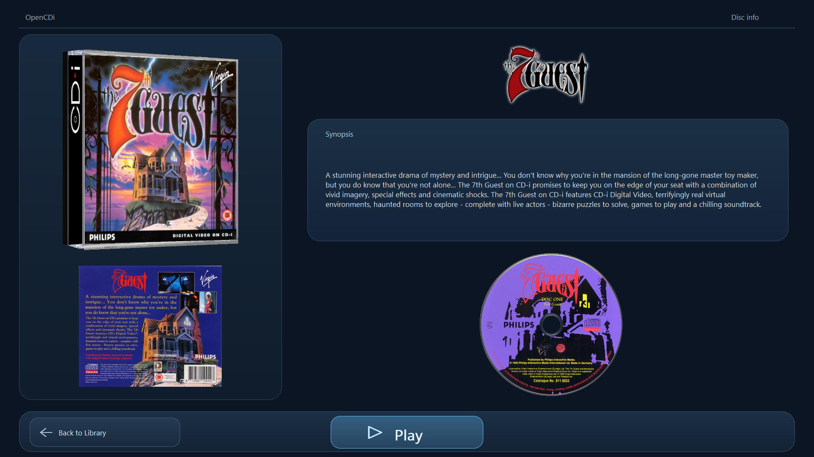

# OpenCDi

OpenCDi is an open source Philips CD-i emulator written in Rust. This fork adds a Windows library and settings interface with configurable CD-i controls, per-disc profiles, automatic artwork, and a pause menu.

## Windows download

Download **OpenCDi-Windows-x64.zip** from the [Releases](../../releases) page and extract it. Run `opencdi.exe`. The archive includes a quick-start guide. Windows x64 is required.

OpenCDi does not include Philips firmware. Place a legally obtained system BIOS named `cdi220b.rom` in `%APPDATA%\OpenCDI\BIOS`. For FMV titles, place `vmpega.rom` in the same folder. Create a `Portable` folder beside `opencdi.exe` before first launch to keep settings, firmware, artwork, saves, and profiles beside the app instead.

## Interface

With no command-line arguments, OpenCDi opens the disc library. Single-click a disc to see its artwork and synopsis, then choose Play. The floating toolbar includes Open Disc, Controller, Start 220, Start 490, Settings, About and Exit. Settings offers BIOS 220/490 choices with a tick beside the selected system.

Mouse, gamepad and DolphinBar Mode 4 Wiimote controls remain enabled together. Press the configured pause control or the mouse wheel during a game to open pause; use Resume or right click to return. From a standalone BIOS, the pause control returns directly to the library. Per-disc memory and save states are kept in separate 220/490 folders.

See [Quick Start for Windows](docs/QUICK_START_WINDOWS.md) for setup, controls, paths, and per-disc configuration details.

See the [interface screenshot gallery](screenshots/README.md) for the library, controller settings, new disc-info screen, Settings menu, and About dialog.



## Build from source

Install Rust and Cargo, then run:

```powershell
cargo build --release --bin opencdi
```

The executable is written to `target/release/opencdi.exe` on Windows. The project also builds on Linux; platform development libraries may be required by the window and audio backends.

## License

The project is distributed under the MIT License. See [LICENSE](LICENSE).
