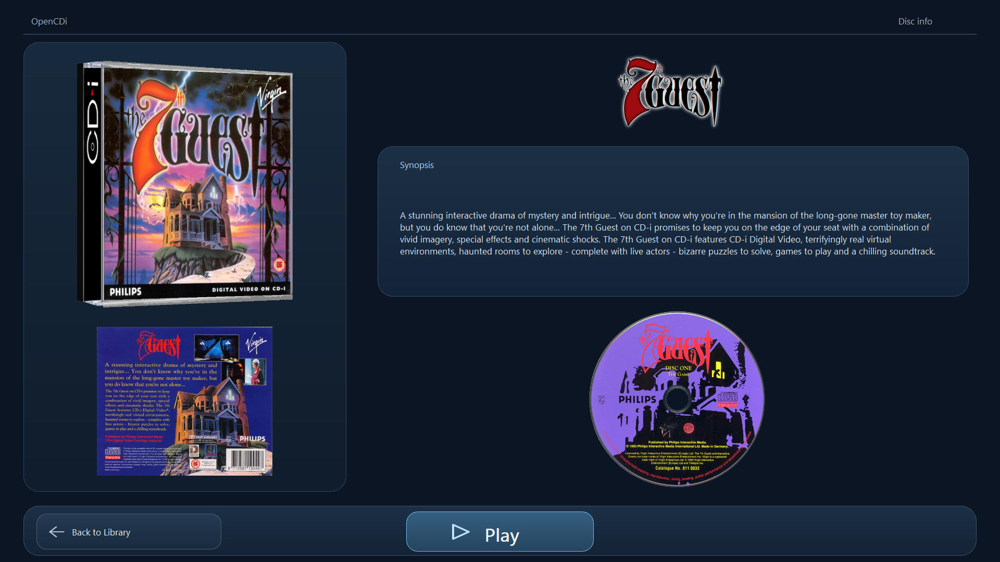
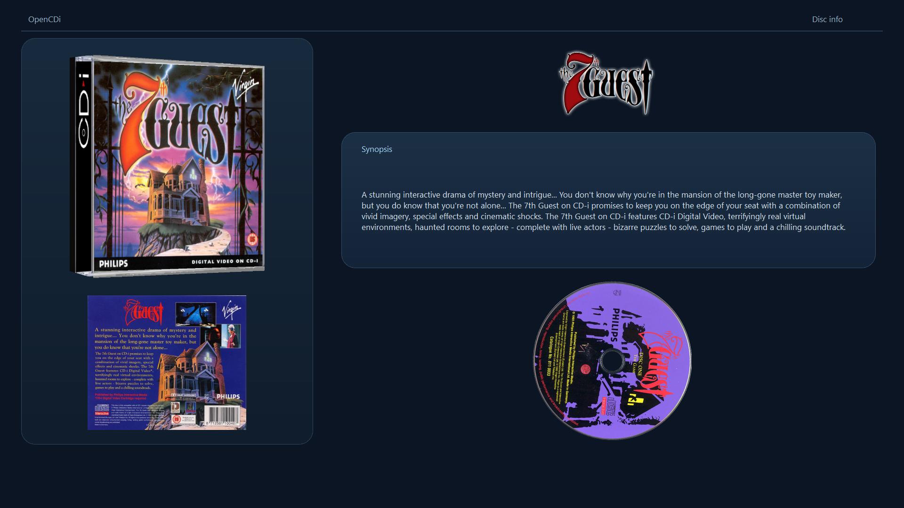
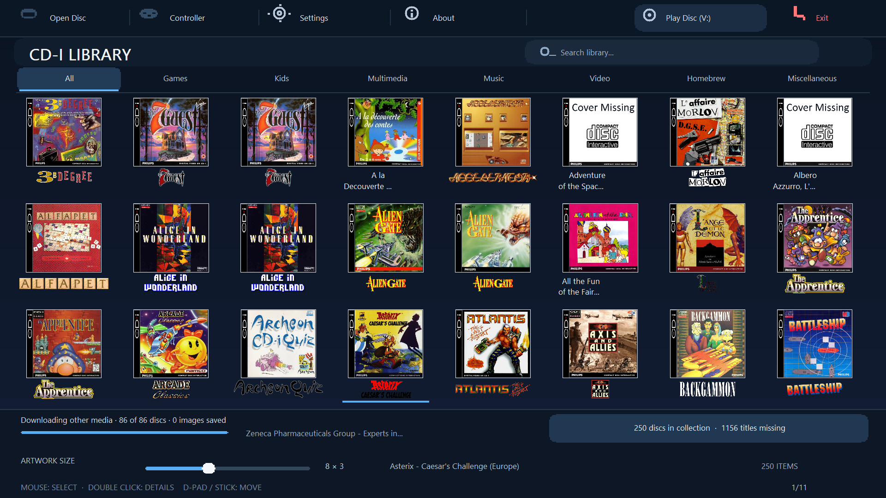
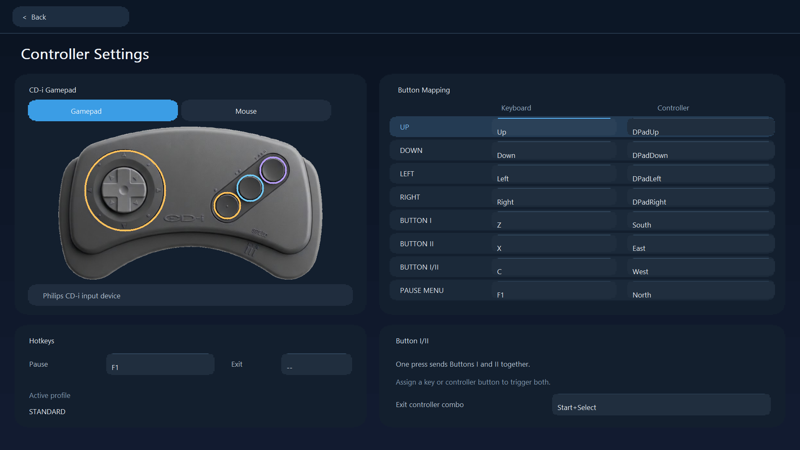
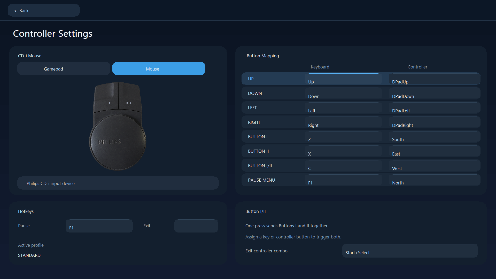
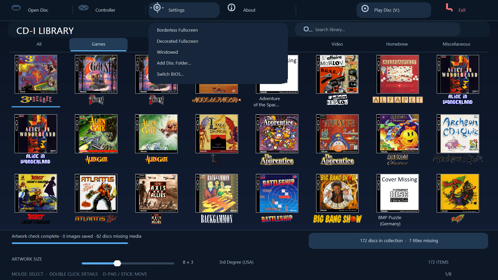
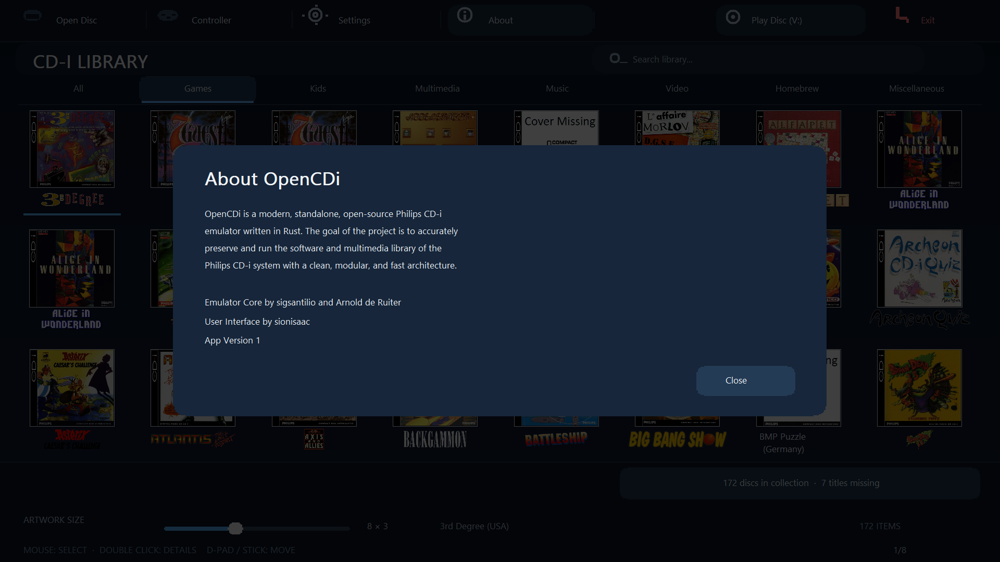

# OpenCDi Interface

## Disc Info (v0.2.4)

These images are generated by the app renderer using local artwork. The screenshots below show the earlier interface.

## Library

## Controller Settings

## Settings Menu

## About

The earlier [design references](reference/) are also available.
